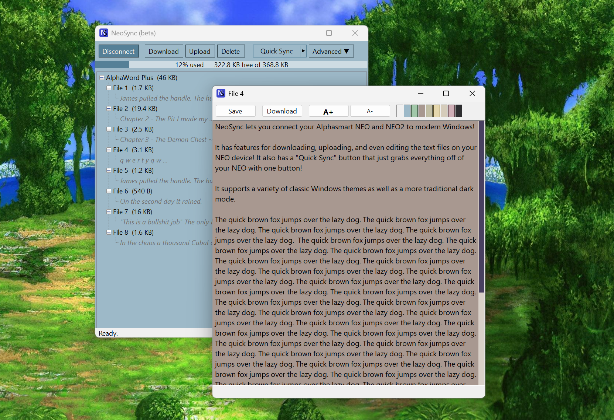

# NeoSync



A Windows tool for the AlphaSmart Neo and Neo2. It connects over USB, switches
the device into transfer mode, and lets you download or upload AlphaWord text
files without needing the original AlphaSmart Manager software.

This is an independent, unofficial project. It is not affiliated with or
endorsed by Renaissance Learning or AlphaSmart.

## What it does

- Connects to a Neo over USB and switches it from keyboard mode into file
  transfer mode automatically.
- Lists the AlphaWord files on the device, with size and a short content
  preview.
- Downloads and uploads files as plain text.
- Quick Sync: one click to pull every file on the device into a folder on
  your PC, backing up whatever was already there first.
- Installs its own WinUSB driver for the device, since Windows blocks direct
  USB access to a device that is enumerated as a keyboard.
- Optional classic Windows 2000-style color themes, picked from swatches in
  the Advanced menu.

## Requirements

- Windows 10 or later, 64-bit.
- An AlphaSmart Neo or Neo2.
- Administrator rights for the one-time driver install (the installer asks
  for this itself; day-to-day use afterward does not require running as
  admin).

## Installing

Download the latest installer from the [Releases page](https://github.com/linksdeity/NeoSync/releases) and run it.

The installer isn't code-signed yet, so Windows SmartScreen will likely show
a "Windows protected your PC" warning when you run it. This is expected for
a small unsigned tool, not a sign that anything is wrong. Click "More info",
then "Run anyway" to proceed.

If Windows 11's **Smart App Control** is enabled, it may block the installer
outright with no "run anyway" option at all ("Smart App Control blocked an
app that may be unsafe"). If you hit this, you'll need to temporarily turn
it off to install:

1. Open **Windows Security** > **App & browser control** > **Smart App
   Control settings**, and set it to **Off**.
2. Run the installer as normal.
3. Turn Smart App Control back **On** afterward from the same settings page.
   Recent Windows updates allow it to be re-enabled this way without needing
   a clean install.

Once running, the installer will:

1. Ask you to accept a short disclaimer (this is unofficial, third-party
   software, use at your own risk).
2. Install a signed WinUSB driver for the Neo's two USB modes.
3. Ask you to connect or reconnect the Neo so it can do the first mode
   switch.

After that, the Neo will no longer work as a plain USB keyboard on that PC,
since NeoSync's driver replaces the keyboard driver in order to talk to the
device directly. This can be undone from Advanced > Repair NeoSync > Remove
WinUSB drivers in the app, followed by unplugging and replugging the Neo.

## Using it

Open NeoSync, plug in the Neo, and click Connect. Once connected, select a
file in the tree and click Download or Upload, or use Quick Sync to pull
everything at once. Advanced options -- repairing or removing drivers,
diagnostic logging, checking for updates, and color themes -- are under the
Advanced menu. Driver and service troubleshooting is consolidated under
Advanced > Repair NeoSync.

## Using the text preview editor

NeoSync has a built in text previewer and editor (refered to as the "preview editor"), for the files stored on it. To access it: double-click on the text preview in the AlphaWord tree that you want to open. A new window will load containing the full text of the file.

In the preview editor you can review a file's full text before downloading it - and also make edits. It can even use it as a streamlined text editor for writing. To save the file after making edits click "Save", this saves your changes to the file stored on the Neo directly. Click "Download" to download the current text file to your computer (this includes any changes you've made in the preview editor, even if you have not clicked 'Save' yet).

The preview editor has buttons for increasing and decreasing the font size, as well as a pallette of quick themes to help make reading text easier. (It defaults to your current theme selected in the Advanced menu).

## To-do

1. Improve the file tree, it's very basic and could be made much simpler/cleaner.
2. Allow drag and drop text files.
3. Support applet files.
4. Support Neo system updates.
5. Add more fucntionality to the preview editor (line numbers, zebra striping, character/word count, etc).

## Building from source

Requires the .NET 10 SDK and Inno Setup 7.

```powershell
dotnet build NeoSync.slnx -c Release
```

To build the full installer (publishes the app and the background service,
then compiles the Inno Setup script):

```powershell
powershell -ExecutionPolicy Bypass -File installer\build.ps1 -Version "0.9.10"
```

This requires a pre-signed WinUSB driver package in `installer\driver\`. See
`installer\driver\create-driver-package.ps1` to generate one (needs a code
signing certificate).

See `NOTES.md` for protocol details, architecture notes, and known issues.

## How it works, briefly

The Neo has two USB personalities: it enumerates as a keyboard by default,
and switches into a bulk transfer mode on request. NeoSync sends that
switch command, then talks to the device using AlphaSmart's file transfer
protocol to list, read, and write files. A small background service
(NeoSyncHelper) handles the driver installation and mode switching, since
those operations need administrator rights that the main app does not
otherwise require.

## Credits

NeoSync's understanding of the USB protocol and file formats was developed
by reading two existing open source projects as reference:

- [AlphaSync](https://github.com/tSoniq/alphasync), a macOS tool for the same
  hardware.
- [neotools](https://github.com/rbanffy/neotools), a Linux command-line tool
  for the same hardware.

No code from either project was copied. See `THIRD_PARTY_LICENSES.txt` for
full attribution.

## License

MIT. See `LICENSE`.
